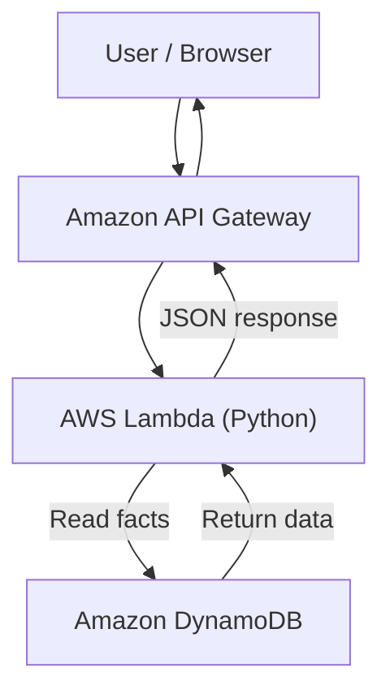
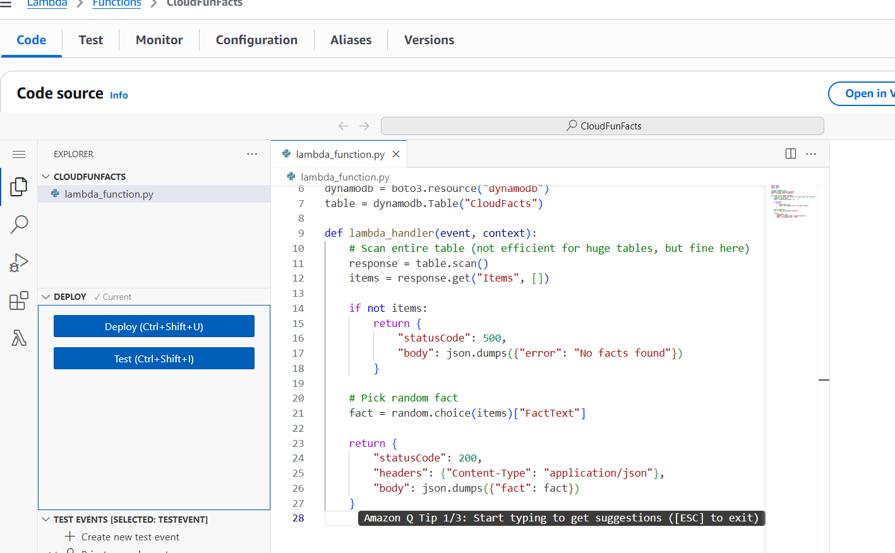
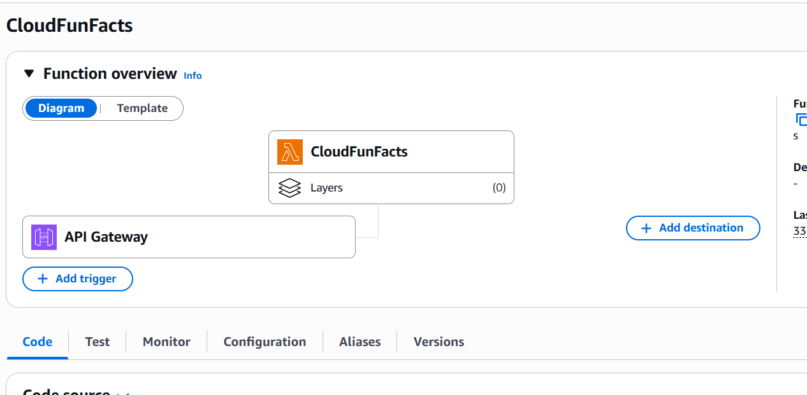
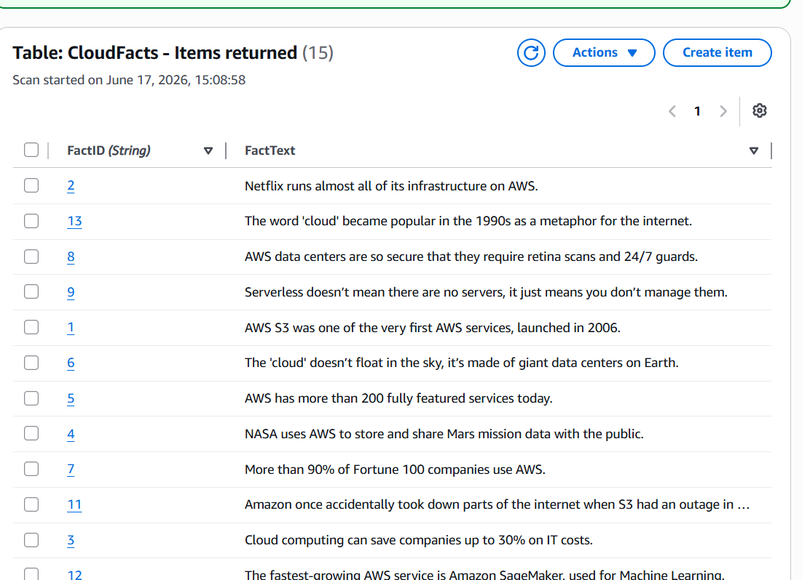
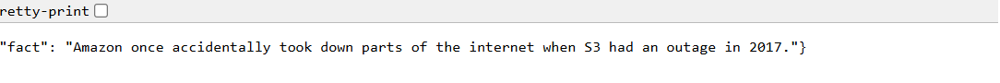

## AWS Cloud Fun Fact Generator

This is a hands-on AWS project I built to better understand how different AWS services work together.

The application returns a random fact about AWS or cloud computing through an HTTP API. I started by storing the facts directly in a Python Lambda function, then moved them into DynamoDB so I could add or update facts without having to change the Lambda code each time.

## AWS Services Used

AWS Lambda (Python): Runs the code that retrieves and returns a random cloud fact.

Amazon API Gateway: Provides an HTTP endpoint that allows users to request a fact.

Amazon DynamoDB: Stores the cloud facts.

AWS Identity and Access Management (IAM): Gives the Lambda function permission to read data from DynamoDB.

## Architecture

The application uses API Gateway, AWS Lambda, and DynamoDB to retrieve and return a random cloud fact.

IAM permissions allow Lambda to read the DynamoDB table.

## How It Works

A user sends a request to the API Gateway endpoint.

API Gateway triggers the Lambda function.

Lambda scans the DynamoDB table and randomly selects a cloud fact.

Lambda returns the selected fact as a JSON response through API Gateway.

## Building the Project

## Part 1 — AWS Lambda and API Gateway

I first created a Lambda function using Python and added several AWS fun facts directly into the code.

After creating the function, I used a Lambda test event to make sure it was working and returning a JSON response.

Once I confirmed that everything worked, I created an HTTP API using Amazon API Gateway and connected it to my Lambda function.

This allowed the function to be triggered through an HTTP request instead of only testing it inside the AWS Management Console.

## Part 2 — DynamoDB and IAM

The next step was moving the cloud facts out of the Lambda function and into a DynamoDB table.

I created a table called CloudFacts and added the facts as individual items.

After that, I needed a way for Lambda to access the DynamoDB table. I used IAM to give the Lambda function permission to read the table.

I then updated the Python code so Lambda could retrieve the facts from DynamoDB, randomly select one, and return it as a JSON response.

Finally, I tested the API Gateway endpoint again and confirmed that the updated application was working.

The main reason I made this change was so I could add new facts directly into DynamoDB without having to edit and redeploy the Lambda function every time.

## Part 3 — Amazon Bedrock (Not Implemented)

The final part I considered was integrating Amazon Bedrock to make the returned facts more engaging using AI.

The idea was for Lambda to retrieve a fact from DynamoDB, send it to a foundation model through Bedrock, and return the rewritten fact through API Gateway.

I decided not to implement this part because I wanted to better understand the pricing and billing setup before using a paid model.

This integration remains a possible future improvement and is not part of the current application.

## Project Screenshots

### Lambda Function Code

Python code used to retrieve facts from DynamoDB and return a JSON response.

### Lambda Function Overview

The Lambda function configured with API Gateway as a trigger.

### DynamoDB Table

The CloudFacts table containing the facts used by the application.

### API Response

A successful API request returning a random cloud fact in JSON format.

## What I Learned

This project helped me get more comfortable working with AWS services together rather than just learning about them individually.

Some of the things I practiced were:

Creating and testing Python Lambda functions.

Connecting API Gateway to Lambda.

Using DynamoDB to store and retrieve data.

Configuring IAM permissions between AWS services.

Troubleshooting and testing API responses.

It also helped me understand why separating application code from stored data can make an application easier to update.

## Future Improvements

There are a few things I'd like to revisit as I continue working with AWS:

Improve the DynamoDB data access approach instead of scanning the entire table.

Add better error handling and automated tests.

Explore Infrastructure as Code for deploying the application.

Revisit Bedrock integration after understanding its pricing and usage costs.

This was a learning project focused on gaining practical experience with AWS and understanding how these services communicate with each other.

## Project Status

This project was successfully built and tested in AWS. After completing it, I deleted the original Lambda function since I wasn't actively using it.

The Python code included in this repository was reconstructed from a screenshot of my original implementation. It has not been redeployed or retested.

